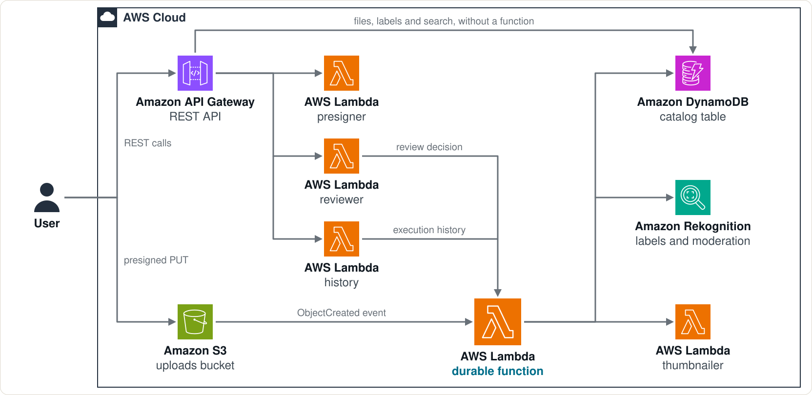
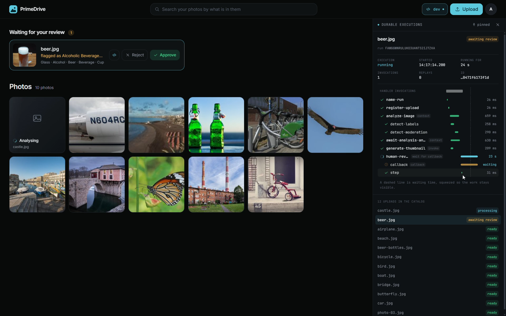

# PrimeDrive on Lambda durable functions

A port of [PrimeDrive](https://github.com/JairJosafath/PrimeDrive-CDK-Project) from
Step Functions to a single **durable Lambda function written in Go**.

A user uploads a photo. The pipeline labels it, checks it for moderation
concerns, makes a thumbnail, asks a person to review it when something looks
off, and indexes it so it can be found by what is in it.

## Architecture

S3 starts the durable function for every upload. When the analysis gives a
reason, the execution suspends until a reviewer answers, and nothing runs
while it waits. Not drawn: Cognito signs users in, thumbnails go to a second
bucket, and the event of a failed execution is kept in a queue.

## The demo

`beer.jpg` waits for a reviewer. The **dev** panel on the right shows its
execution: every operation the durable function ran, and the callback it is
suspended on.

## Run it

`make` lists every target.

| You want to | Run |
| --- | --- |
| Check everything before a push: lint, tests, synth | `make check` |
| Try the whole app on your machine, without AWS | `make local`, then `make local-seed` in a second terminal |
| Deploy to AWS | `make deploy` |
| Get a user to sign in with, and its password | `make user NAME=alice` |
| Put sample photos in that user's drive | `make seed NAME=alice` |
| Open the web page against the deployment | `make web` |

## Where things are

What runs in AWS:

| Path | What it is |
| --- | --- |
| `cmd/pipeline/`, `cmd/thumbnailer/`, `cmd/presigner/`, `cmd/reviewer/`, `cmd/history/` | The five Lambda functions |
| `internal/pipeline/` | The durable workflow and its tests: [how it works](docs/workflow.md) |
| `internal/drive/` | The domain and the review policy; no AWS, no durable SDK |
| `internal/aws/` | The adapters: S3, DynamoDB, Rekognition and the Lambda API |
| `internal/api/`, `internal/thumbnail/`, `internal/execution/` | What the other four functions do |
| `infra/` | The CDK app: [deploying, and the data model](infra/README.md) |
| `frontend/` | The Next.js page: [the drive and its dev mode](frontend/README.md) |

What only runs on your machine is in a directory named `local`, wherever it
belongs: `local/`, `cmd/local/`, `internal/local/`, `tools/local/` and
`frontend/src/local/`. [The local flow](local/README.md) says what each holds
and how the local stack differs from the cloud.

`tools/` has the scripts behind the make targets.
